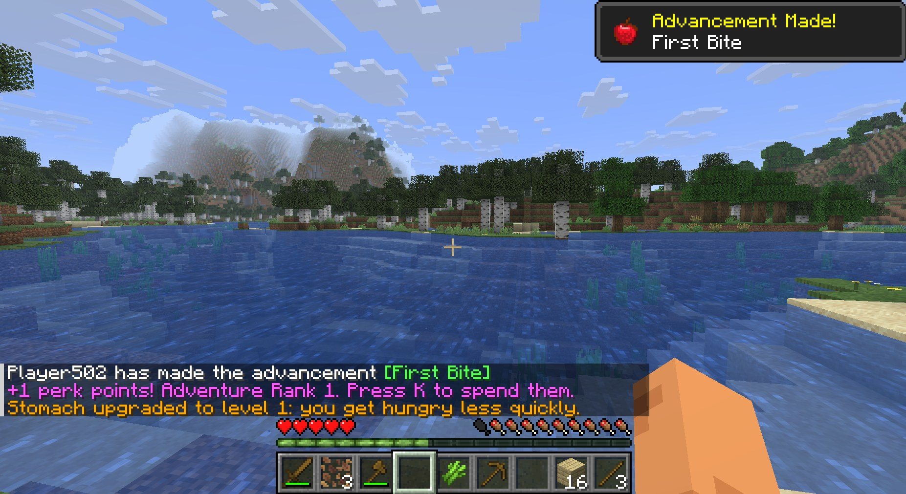
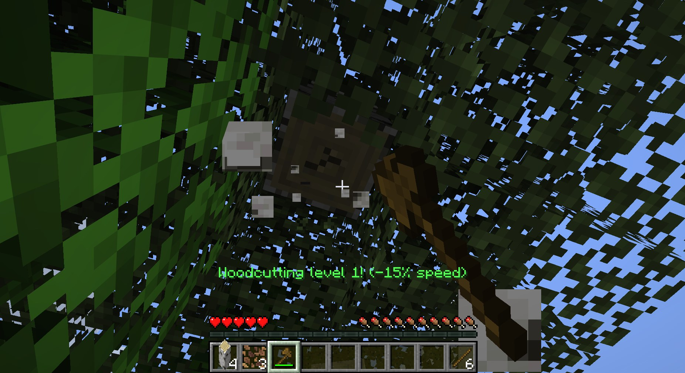
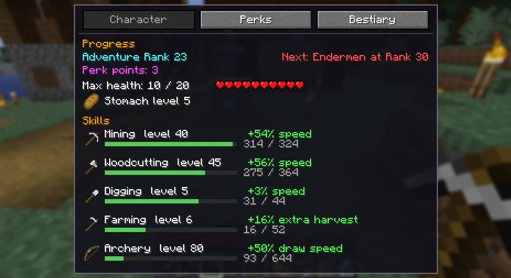
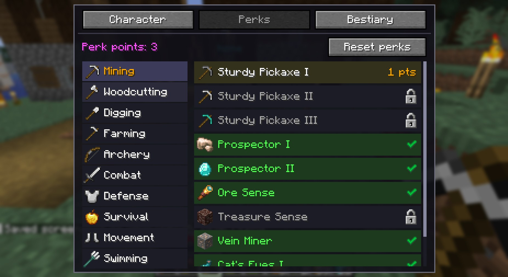
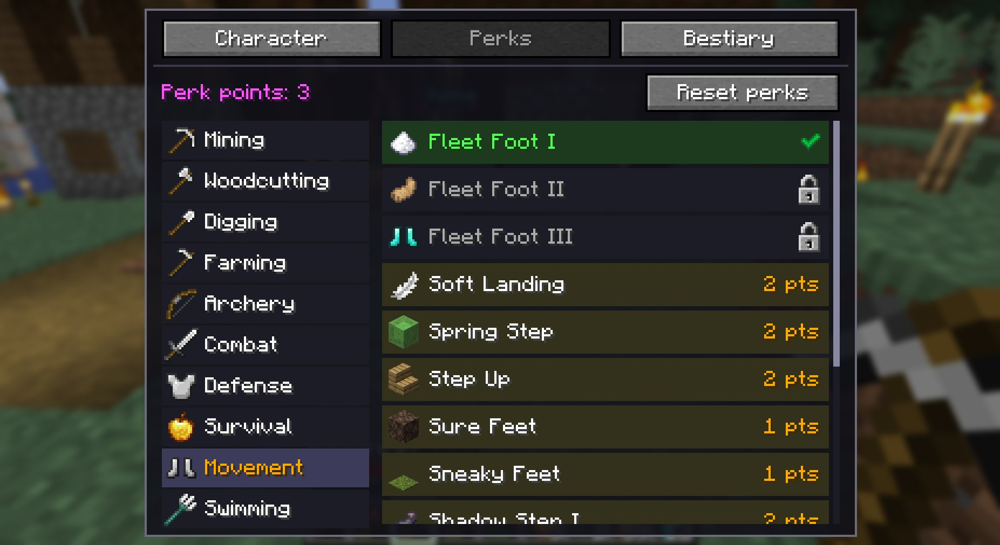
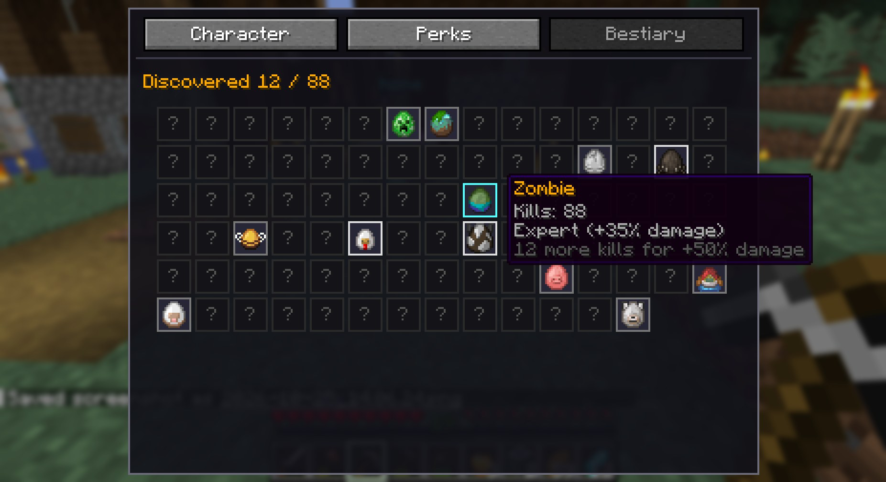
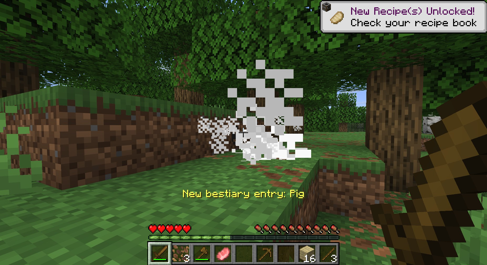
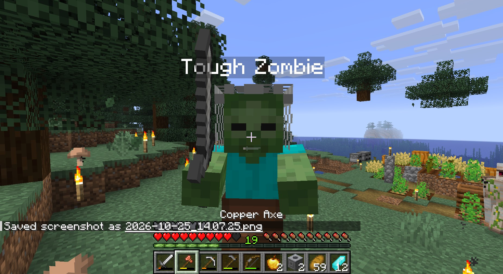
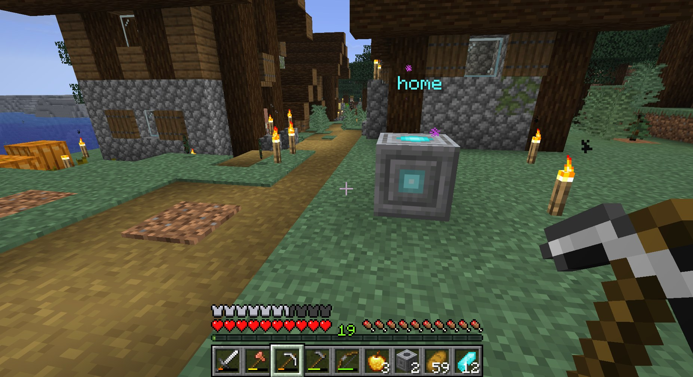
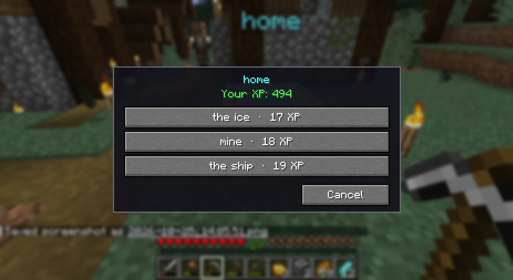

<p align="center">
  
</p>

<h1 align="center">PAM: Progressive Adventure Mod</h1>

<p align="center"><b>Start weak, grow strong.</b><br>
A Fabric mod for Minecraft 26.2 where you and the world grow stronger together.</p>

---

In vanilla Minecraft you spawn with full health, and every mob is out to get you on night one.
After that, the only way to grow is better gear.

PAM changes that. You start with **fewer hearts** and a **hungrier stomach**, and you earn your
strength back by playing: reaching milestones, getting better at what you do, and exploring.
The world grows with you. New monsters only show up once you're ready for them.

There is **no death penalty**. PAM is made to be fun for families and kids, and progress is
always shown on screen so it's clear what you've done and what's next.

> **Alpha:** this is the first public version. Expect rough edges and balance changes.
> Feedback is very welcome, see [Feedback and ideas](#feedback-and-ideas).

## Features

### Hearts from milestones
You start with **5 hearts**. Milestones give you more, up to **20 hearts**. Your first night,
your first new food, finding a village, beating the Wither: **44 milestones** in total. 26 are
in PAM's own **Adventure** advancement tab, and 18 are vanilla advancements that now give a reward too.



### A stomach that grows
Early on you get hungry quickly and food fills you up less. Eating different foods and growing
crops levels up your **stomach**, until you're better off than in vanilla.

### Get better by doing
Seven skills level up as you use them: **Mining**, **Woodcutting**, **Digging**, **Farming**,
**Melee**, **Archery** and **Fishing**. Higher levels mean faster tools, extra harvests, faster attacks, quicker
bow draws and faster bites.



### Adventure Rank and perks
Every advancement raises your **Adventure Rank**, and every Rank is a **perk point**. Spend them
on **121 perks** in 10 categories: Vein Miner, Timber, Replant, Double Jump, Mantle, Whirlwind, Parry, Ore Sense,
Cat's Eyes, Shadow Step and many more. You can reset your perks at any time.

Press **K** to open the Adventure screen.





### Bestiary
Every mob type you defeat goes in your bestiary. The more of a mob you've beaten, the more
damage you deal to it. Click a mob to open its page: where to find it, and as you get to know it
better its stats and a tip, what it drops, and at Master a chance of double loot. Collect sets of
mobs (night monsters, Nether, End, raiders, ocean) for extra Adventure Rank. When friends fight a
mob together, everyone who hit it gets the kill in their bestiary. On an elite, they also get the
Elite Slayer milestone and, the first time, a Waypoint Shard.




### The world opens up as you grow
On your first night only zombies come out. Skeletons, creepers, spiders, endermen and the rest
unlock as your Adventure Rank goes up, and you get a chat message when a new mob type can
appear. Later on, mobs start wearing gear, and rare **elite** mobs show up: bigger and tougher,
with special traits and better loot. Some elites drop a treasure or explorer map.



### Achievements and tips
The Adventure screen shows every achievement in one grid, so you can see what's left. Stuck on one? Buy a tip with
a bit of XP, or read the free tip of the day.

### Waypoints
Elites can drop **Waypoint Shards**. Craft a **Waypoint Stone** (8 stone bricks around a
compass), turn it on with shards and give it a name. Then travel between your stones for a
bit of XP. Pets come along.




## Multiplayer

PAM works on dedicated servers and LAN. Every player has their own hearts, skills and perks,
so friends at different progress levels can play together. Mob unlocks follow the
**lowest-ranked player nearby**, so a new player is never thrown in at the deep end.

## Installation

1. Install [Fabric Loader](https://fabricmc.net/use/) for Minecraft **26.2**.
2. Download [Fabric API](https://modrinth.com/mod/fabric-api).
3. Put both jars and the PAM jar in your `mods` folder.

Or let a script do steps 2 and 3. It puts the latest PAM and the right Fabric API in your `mods`
folder, and running it again updates PAM. Open a terminal and paste:

- **Windows** (PowerShell): `irm https://raw.githubusercontent.com/joelharkes/pam/main/install.ps1 | iex`
- **Linux and macOS**: `curl -fsSL https://raw.githubusercontent.com/joelharkes/pam/main/install.sh | bash`

PAM is needed **on both the client and the server**.

## Config

PAM works out of the box; you don't need to change anything. To change a setting (starting
hearts, hunger, skill speed, elite chances, waypoint costs, ...):

1. Look in `config/progressive_adventure.defaults.json` for every setting and its default.
   This file is rewritten each time the game starts, so changing it does nothing.
2. Copy only the settings you want to change into `config/progressive_adventure.json`, change
   them there, and restart the game or server. For example:

```json
{
  "startingHearts": 10,
  "lockedMobReplacementChance": 0.3
}
```

Everything you don't list follows the mod's defaults, so when an update rebalances something,
you get the new numbers automatically. A list setting is replaced as a whole. On a server, or
when you open a world to LAN, the settings of the server (the host) count.

## Known limitations

- **Removing PAM** from a world doesn't reset hearts: players keep the max health they had.
  An op can undo it per player with
  `/attribute <player> minecraft:max_health modifier remove progressive_adventure:milestone_hearts`.
- **Mob unlocks and elites** only change natural spawns in the Overworld. The Nether, the End,
  spawners, structures (like witch huts) and raids stay vanilla.
- **Land-claim mods:** perks that break blocks (Timber, Vein Miner, ...) follow the normal
  breaking rules. Replant (right-click a grown crop) is only stopped by a claim mod that also
  blocks right-clicking crops.
- **Skill and bestiary settings:** if a server changes skill speed or bestiary settings, players
  whose own config doesn't match may see different numbers on the Adventure screen, and mining
  can feel slightly off. Give players the same settings, or leave these at their defaults.

## Commands

- `/pam`: shows your progress in chat.
- `/pam bestiary`: lists your bestiary.
- Ops only: `/pam elite <mob> [trait]`, `/pam elitemap <type>`, `/pam skill <skill> <level> [player]`, `/pam kills <mob> <count> [player]`,
  `/pam waypoint list|tp|remove`. These are for testing and server admins.

## Feedback and ideas

Found a bug, played a session and have thoughts, or have an idea for a new perk or milestone?
[Open an issue](https://github.com/joelharkes/pam/issues/new/choose). There's a form for each.
See [CONTRIBUTING.md](CONTRIBUTING.md) if you want to help with code.

## License

[MIT](LICENSE)
